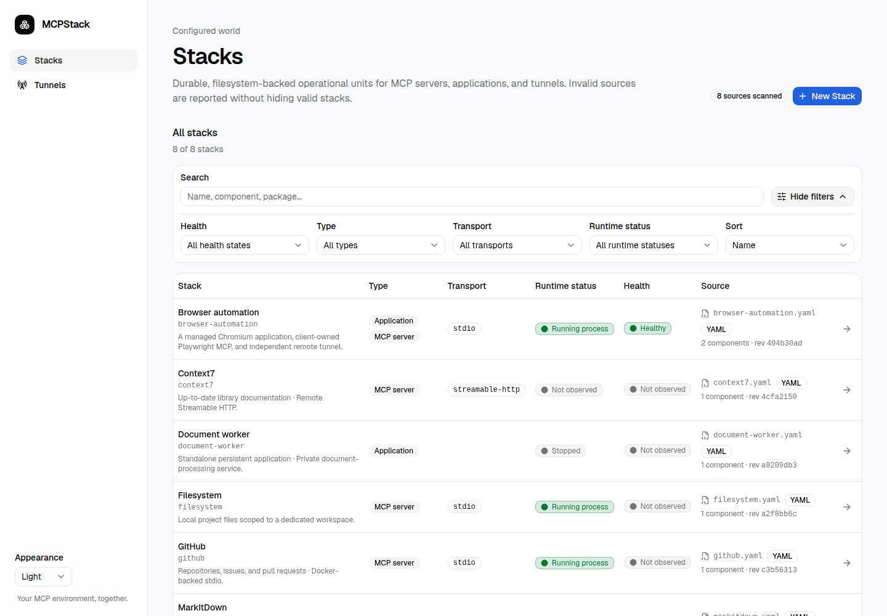
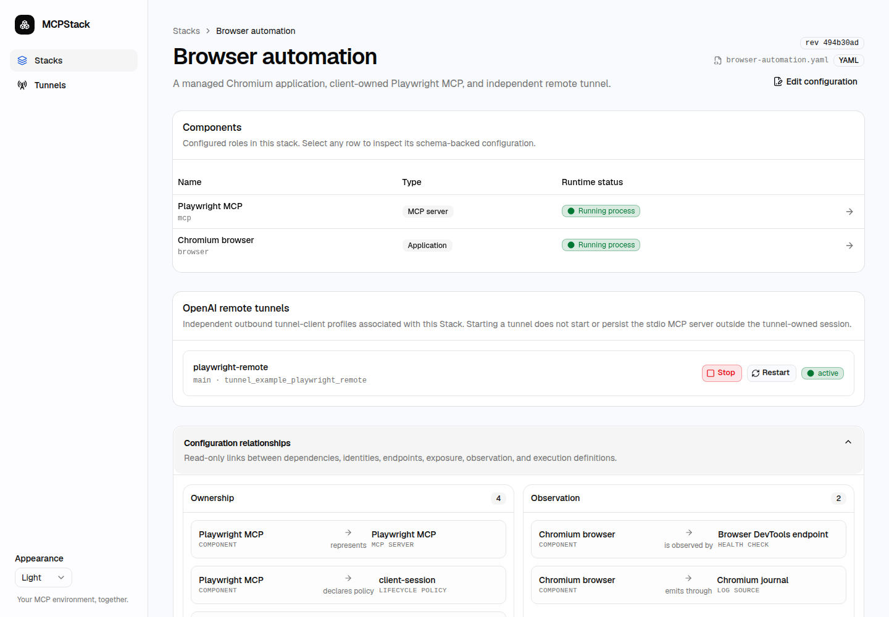
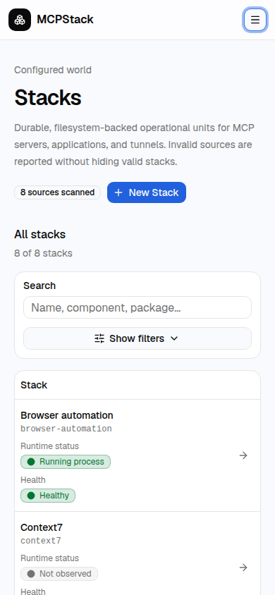
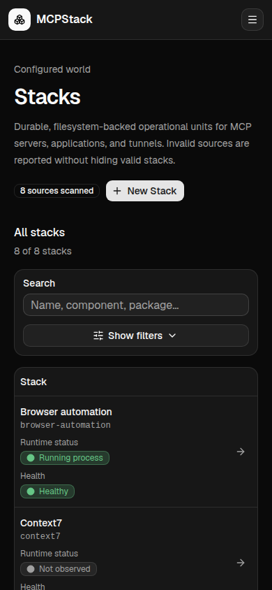
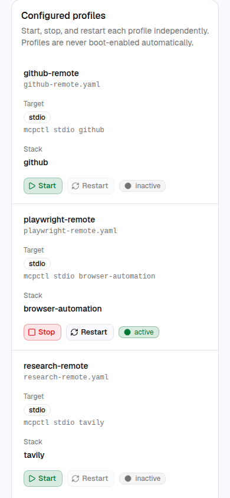

# MCPStack

**Any MCP server. Your setup. One control panel.**

Bring local and remote MCP servers—and the applications, configurations,
credentials, and tunnels behind them—together in one local-first control panel.

Organize related resources into Stacks, manage persistent applications and
tunnels, monitor health, inspect logs, and configure AI client connections
without juggling scattered configuration files or one-off launch scripts.

Keep configurations in files you control and credentials in a private store.
A dedicated service account handles configuration and execution, keeping MCP
clients separate from stored configuration and credentials. Each component
follows the lifecycle that fits it, from client-owned stdio sessions to
independently managed applications and tunnels.

Find every Stack in one searchable collection, whether it runs locally or
connects over HTTP. Runtime and health indicators help you see what needs attention.

<picture>
  <source media="(prefers-color-scheme: dark)" srcset="docs/screenshots/stacks-desktop-dark-viewport.png">
  
</picture>

*Shown with demo configurations and simulated observations—not live services or credentials.*

<details>
<summary>Explore the features — desktop and mobile screenshots</summary>

### Guided configuration, without the guesswork

Build a Stack with familiar form fields and see its YAML take shape alongside
your changes. Validate before saving while keeping files as the source of truth.


### Related resources, one operational Stack

Keep an MCP adapter, its application, and its tunnel together without merging
their identities or lifecycles. Explore the relationships to see what depends on what.



### Control services and understand their behavior

Start, stop, or restart persistent applications, then inspect health and recent
logs in the same view. Process state and health stay distinct so “running” never hides the full picture.


### Connect remotely, on your terms

Manage tunnel profiles from one place and activate each independently of the
service it exposes. Clear state indicators and controls make active profiles easy to spot.


### Configure credentials without revealing them

Bind an environment variable to a private secret slot instead of embedding a
key in your configuration. Replace credentials when needed; stored values are never returned to the editor.


### Your Stacks, pocket-sized

Browse the same collection from your phone, with compact navigation and
readable status indicators. Light and dark appearances keep the interface comfortable in either setting.

<p>
  
  
</p>

### Service diagnostics on the go

Reach application controls, health information, and recent logs without a
desktop-sized screen. Long output wraps within the mobile layout.


### All your tunnel profiles, within reach

Review configured profiles and their target Stacks in a mobile-friendly list.
Start and stop controls stay close to each profile's observed state.



### Drill into a tunnel from anywhere

Open an individual profile to control its lifecycle and inspect recent logs.
Manage remote exposure independently, even from your phone.


[Screenshot details and demo notes](docs/screenshots/README.md)

</details>

## What you can do

- Browse Stacks in a searchable, filterable list.
- Create and edit MCP configurations with a guided form.
- Start, stop, and restart managed applications and tunnel profiles.
- Inspect runtime status, health checks, relationships, and recent logs.
- Store API keys without a “show secret” endpoint.
- Use light, dark, or system appearance.

A **Stack** is one service, or a set of resources that operate together. For
example, an MCP adapter and the application it connects to can share a Stack.

## Get started

You need Linux with systemd, Python 3.12+, uv, Node.js 24, pnpm 10, and sudo.

From a checkout of this repository:

```bash
pnpm install --frozen-lockfile
uv sync --project backend --frozen
cp .env.example .env
./scripts/install-service.sh
```

The installer builds as your normal user, then asks for sudo. It installs and
starts the web UI, API, and execution broker as dedicated service accounts.

Open **[http://127.0.0.1:3100/stacks](http://127.0.0.1:3100/stacks)** and choose
**New Stack**. Individual MCP packages and applications are installed separately.

| I want to… | Read |
| --- | --- |
| Install, update, or configure a public origin | [Installation](docs/installation.md) |
| Add a Stack, connect a client, or manage a tunnel | [Usage](docs/usage.md) |
| Fix a startup, permissions, or connection problem | [Troubleshooting](docs/troubleshooting.md) |
| Build from source or contribute | [Contributing](CONTRIBUTING.md) |

## How execution works

Stdio MCP servers belong to the client session:

```text
MCP client → mcpctl → execution broker → configured MCP server
```

They are not converted into always-running services, and their protocol traffic
does not pass through the web API. Persistent applications and tunnels have
separate Start/Stop/Restart controls.

The backend runs as `mcp-stack`; the web frontend uses a separate,
less-privileged account. Configuration and secrets live under
`/var/lib/mcp-stack/`. See [operations](docs/operations/local-control-plane.md)
for paths, backups, and service commands.

## Security

> [!IMPORTANT]
> This is a trusted local administration tool, not a multi-user hosting platform.
> Only configure software and commands you trust.

The UI and API bind to loopback by default. If you expose the UI remotely, put
authentication in front of it and allow the exact HTTPS origin. API keys belong
in the control plane's private secret store, **not** in `.env`.

Managed MCP implementations share a service identity; they are not isolated
from each other. See [SECURITY.md](SECURITY.md) for the full boundary and how to
report a vulnerability.

## Project details

FastAPI backend · Next.js frontend · JSON Schema/OpenAPI contracts ·
filesystem-backed configuration

The command is `mcpctl`; services, directories, and package names use `mcp-stack`.

- [Documentation](docs/README.md)
- [Configuration and API contracts](schemas/README.md)
- [Example configurations](config/)
- [MIT license](LICENSE)
