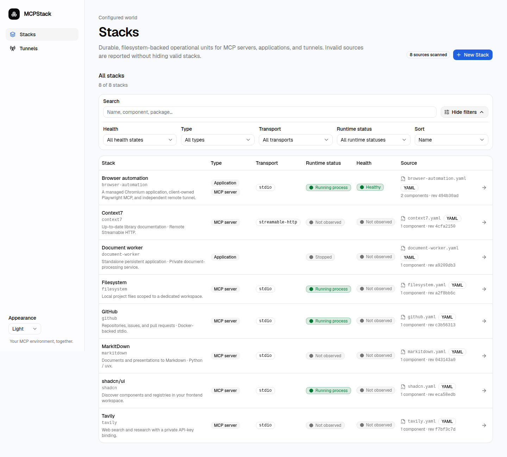

# Install MCPStack

## Requirements

- A Linux host with systemd and sudo (developed on Ubuntu)
- Python 3.12+ and [uv](https://docs.astral.sh/uv/getting-started/installation/)
- Node.js 24 and pnpm 10 (the exact pnpm version is in `package.json`)
- Git and Bash

Windows and macOS are not supported deployment targets for this installer.

MCPStack uses `mcp-stack` for installed accounts, paths, packages, and services,
and `MCP_STACK_*` for environment settings. The client command remains `mcpctl`.

## Install

Download or clone this repository, then open its directory:

```bash
pnpm install --frozen-lockfile
uv sync --project backend --frozen
cp .env.example .env
```

For local-only access, leave the settings empty. For remote browser access,
edit `.env` first:

```dotenv
MCP_STACK_PUBLIC_ORIGINS=https://mcp.example.com
MCP_STACK_TUNNEL_BUNDLE=
```

Run as your normal user—not with sudo:

```bash
./scripts/install-service.sh
```

The script builds first, asks for sudo, and installs three dedicated services.
Open **http://127.0.0.1:3100/stacks**. A fresh installation starts with no Stacks;
choose **New Stack** to add one.

> [!NOTE]
> The control-plane services are enabled at boot. Applications and tunnels you
> add are **not** automatically started or boot-enabled.

<details>
<summary>Preview: your control panel after adding Stacks</summary>

Bring local commands, HTTP endpoints, and managed applications into one
searchable collection. This populated example uses demo data; a new installation starts empty.



</details>

## Deployment settings

The installed settings file is:

```text
/etc/mcp-stack/deployment.env
```

It contains **non-secret settings only**. Use one `KEY=value` per line, quote
values containing spaces, and use absolute paths. Shell commands, `export`,
`$HOME`, and `~` expansion are not supported.

| Setting | Purpose |
| --- | --- |
| `MCP_STACK_PUBLIC_ORIGINS` | Exact browser origins, comma-separated; empty means loopback only |
| `MCP_STACK_TUNNEL_BUNDLE` | Optional directory containing executable `tunnel-client` and `cloudflared` files |

Settings precedence is: exported variables → checkout `.env` → installed file.
An explicitly empty value clears that setting. To use another local file, set
`MCP_STACK_DEPLOYMENT_ENV=/absolute/path/to/deployment.env` when installing.
Updates preserve installed settings when no local/exported override is supplied.
Updates of an existing `mcp-stack` installation can recover its API-unit origin
when the settings file is absent.

To change the live origin without rebuilding:

```bash
sudoedit /etc/mcp-stack/deployment.env
sudo systemctl restart mcp-stack-api mcp-stack-web
```

Also update your local `.env` if it supplies the same setting for future installs.

## Remote access

The frontend listens on `127.0.0.1:3100`; the API on `127.0.0.1:8000`.
Route an **authenticated HTTPS proxy/tunnel** to the frontend only. Set its exact
origin, such as `https://mcp.example.com`, with no trailing slash or path.

An allowed origin is not authentication. Do not expose this administration UI
to untrusted users. Keep the backend private.

## Update

Update your checkout after reviewing local changes, then run:

```bash
pnpm install --frozen-lockfile
uv sync --project backend --frozen
./scripts/install-service.sh
```

Live Stack files, tunnel profiles, and secret slots are preserved. Repository
examples are never copied into your installation. Individual MCP/application
packages must be updated separately.

## Next steps

- [Add your first Stack and connect a client](usage.md)
- [Manage services and back up data](operations/local-control-plane.md)
- [Troubleshoot installation](troubleshooting.md)
