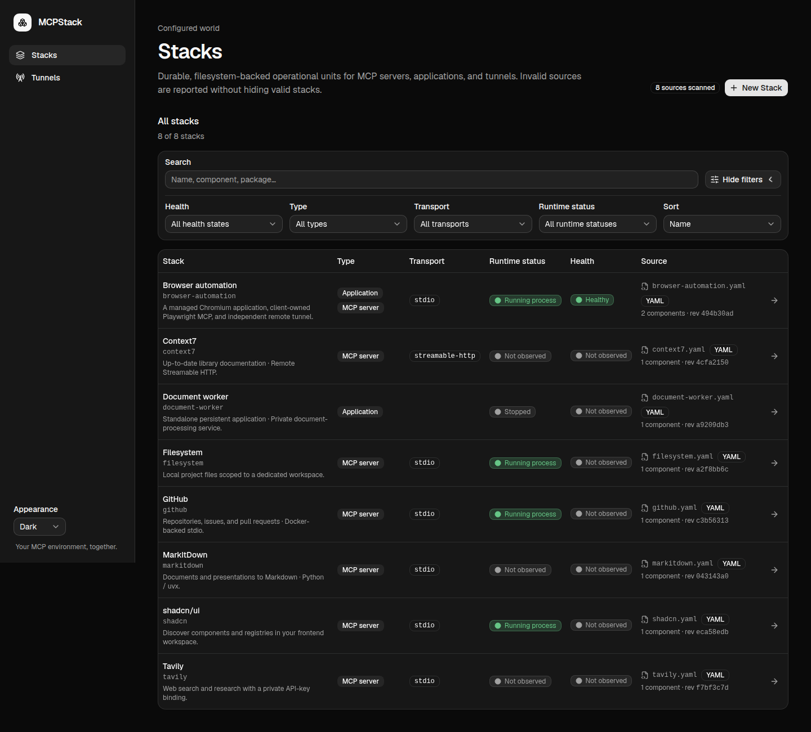

# MCPStack screenshots

Real browser captures of the MCPStack web app, using an isolated temporary demo
API and the production frontend build. No production configuration, stored
credentials, personal hostnames, or real journal output is included.

**Runtime states, sessions, probe results, and log lines are illustrative demo
data.** They demonstrate the UI, not a claim that these upstream services were
installed or launched. Demo lifecycle actions update an in-memory provider;
they do not call systemd. Health examples do not perform network probes.

## Desktop

Captured with a **1440 × 1000** viewport. Collection and relationship images
include the full page; secret bindings are an element capture.

View desktop screenshots

### The configured world — light

Bring local and remote MCP resources into one searchable collection. Independent
runtime and health indicators help you choose where to look next.

### The configured world — dark

Switch to a dark appearance without losing readable controls or meaningful
status colors. The same collection keeps your environment in view.

### Create a Stack

Configure a service with familiar fields and review the generated YAML beside
them. Validate your settings before saving.

### Composite resources

Keep an MCP adapter and the application it uses in one operational Stack.
Explore their dependencies, endpoints, and independent tunnel controls.

### Applications, health, and logs

Manage persistent services and investigate their behavior from the same page.
Health results and recent logs add context beyond a running process.

### Independent tunnels

Review profiles and control each tunnel independently of its target service.
Active and inactive indicators keep remote exposure visible.

### Private credential bindings

Connect environment variables to private secret slots instead of copying keys
into configuration. Replacement fields never reveal stored values.

## Mobile

Captured with **390 × 844** mobile/touch browser emulation at 1× pixel scale.
Controls/log screenshots show a scrolled section rather than shrinking an entire
long page into one image.

View mobile screenshots

### Stacks in light and dark

Take the collection with you in a layout designed for smaller screens.
Compact navigation and status indicators stay readable in either appearance.

  
  

### Application diagnostics

Reach service controls and recent output without switching to a desktop.
Log lines wrap within the mobile view.

### Tunnel profiles

See each profile's target and state in a compact list. Independent controls
remain within easy reach.

### Individual tunnel controls

Open a profile to manage its lifecycle and inspect recent logs. Remote exposure
stays separate from the underlying application's lifecycle.

## Demo configuration coverage

| Stack | Configuration illustrated |
| --- | --- |
| GitHub | Docker-backed stdio, private token reference, concurrent client sessions |
| Context7 | Configured remote Streamable HTTP endpoint |
| Filesystem | Session-owned stdio with a scoped workspace argument |
| MarkItDown | Python package runner (`mise exec -- uvx`) |
| Tavily | npm runner and a required write-only API-key binding |
| shadcn/ui | npm-based stdio for component/registry tooling |
| Browser automation | Playwright MCP plus an independently managed Chromium Application and associated tunnel profile |
| Document worker | Standalone persistent Application, without an MCP adapter |

The eight documents passed the normal discovery/schema/domain pipeline. Three
fictional tunnel profiles demonstrate independent activation. Package selectors,
installation paths, and tunnel identifiers are examples, not a provisioning
guide. No npm/Python package or container image was installed for this capture.
Only a clearly fake credential placeholder was placed in the disposable store
to exercise the normal tunnel-log redaction boundary.

Upstream references: [GitHub MCP](https://github.com/github/github-mcp-server),
[Context7](https://github.com/upstash/context7),
[Filesystem](https://github.com/modelcontextprotocol/servers/tree/main/src/filesystem),
[MarkItDown](https://github.com/microsoft/markitdown),
[Tavily](https://github.com/tavily-ai/tavily-mcp),
[shadcn MCP](https://ui.shadcn.com/docs/mcp), and
[Playwright MCP](https://github.com/microsoft/playwright-mcp).
