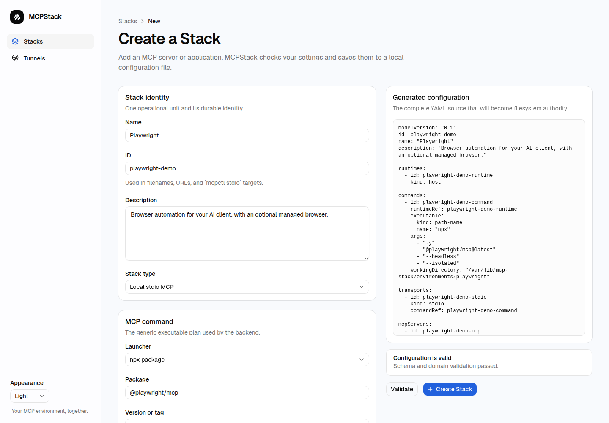
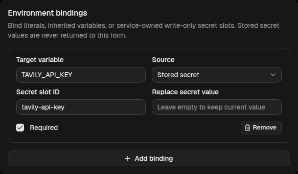
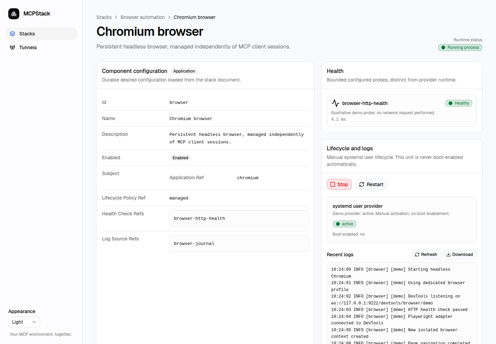
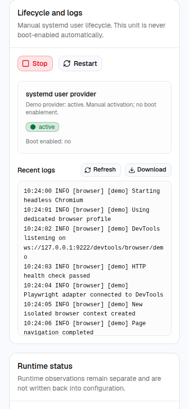
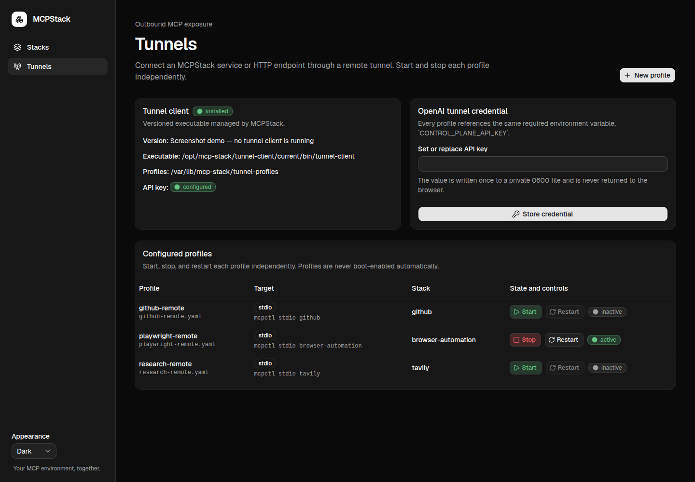
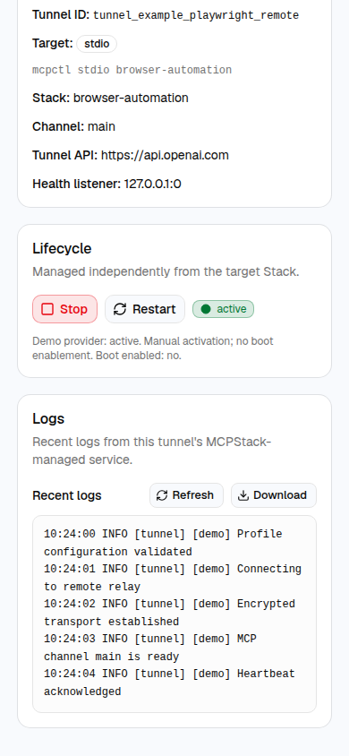

# Usage

Screenshots below use [demo configurations and simulated observations](screenshots/README.md).

## Add a Stack

Open **Stacks → New Stack** and choose:

| Type | Use it for |
| --- | --- |
| Local stdio MCP | A command started for each MCP client session |
| HTTP MCP endpoint | An MCP server already listening at a URL |
| Managed persistent Application | A long-running program controlled by Start/Stop/Restart |

Give it a short ID, a name, and its command or endpoint. You can attach a
managed Application to a stdio/HTTP MCP when they operate together. Independent
MCP services should be independent Stacks.

**Saving configuration does not install software.** Install the package/runtime
separately, make it accessible to the `mcp-stack` account, and then test
the command. Programs should not rely on your interactive shell's PATH or home.
For mise-managed npm/Python runners, use the native `mise` executable with
`exec`, `--`, and the runner arguments, plus a service-owned working directory
containing a trusted `mise.toml`.

See the [generic examples](../config/README.md) for command, environment,
application, HTTP, and tunnel layouts. Example packages/paths are placeholders.

<details>
<summary>Preview: create a Stack and connect its resources</summary>

Use form fields to build your configuration while reviewing the generated YAML.
Validation checks the candidate before it becomes your Stack's saved source.



Related applications and adapters can share a Stack while remaining separate
Components. The relationship view makes their dependencies and endpoints easy to follow.


</details>

## Connect a stdio client

The client command is:

```bash
mcpctl stdio your-stack-id
```

For a client using Codex-style TOML:

```toml
[mcp_servers.example]
command = "/usr/local/bin/mcpctl"
args = ["stdio", "your-stack-id"]
```

Restart the client session after changing its MCP registration. Its stdio
server runs only for that session; there are no persistent Start/Stop buttons.

The installer grants broker access to an existing `codex` account. Other local
accounts require both socket-group membership and an allowed UID; see
[permissions troubleshooting](troubleshooting.md#client-permission-errors).

## Connect an HTTP client

Use the configured server's MCP URL in the client:

```toml
[mcp_servers.example]
url = "https://mcp.example.com/mcp"
```

An HTTP Stack does not itself start the remote server. If this control plane
also manages its local Application, start that Application separately.

## Add API keys

Use an environment binding of type **Secret** in the Stack editor. Give the
secret slot a stable ID and enter its value. After saving, the UI shows whether
it is configured, but never returns the stored value. An empty replacement
field keeps an existing secret; use the explicit clear action to remove it.

Do not put keys in literal bindings, command arguments, YAML examples, or `.env`.
Restart the consuming Application or create a new stdio client session after
changing its environment or secrets.

<details>
<summary>Preview: bind a private secret</summary>

Reference a private slot from an environment binding rather than placing a key
in YAML. The editor accepts replacements without displaying a stored value.



</details>

## Edit or delete

Open a Stack and choose **Edit**. Validate the candidate, review errors, then
save. If another change reached disk first, reload rather than overwriting it.

An attached Application can be removed separately. Deleting a whole Stack asks
for confirmation and lists the affected resources. It stops owned managed
Components and associated tunnels, removes their configuration, and cleans up
Stack-scoped secret slots. It does not delete arbitrary application data.

## Applications, health, and logs

Persistent Components have Start/Stop and Restart controls. A running process
is not necessarily healthy; inspect health checks and recent logs separately.
Stdio execution observations prove process liveness, not MCP protocol connectivity.
Stdio MCP stdout is reserved for the protocol and is not captured as a web log.

<details>
<summary>Preview: service controls, health, and logs</summary>

Control persistent applications and inspect their health and recent output in
one place. Runtime and health remain separate signals.



The same controls and readable log output are available on smaller screens.



</details>

## Tunnels

Install a compatible tunnel-client bundle separately and set its directory in
the deployment settings before running the base installer. Then open
**Tunnels**, enter the shared API key, and create a profile for a stdio target or
HTTP endpoint. Use an identifier issued for your own tunnel—not an example ID.

Profiles have independent Start/Stop/Restart controls, detail pages, and logs.
Starting an Application does not automatically start its tunnel. The shared
tunnel key remains when an individual profile is deleted.

<details>
<summary>Preview: independent tunnel profiles</summary>

See configured profiles and manage their activation independently of their
target Stacks. Each profile has its own detail view and recent logs.



Open a profile on mobile to inspect its logs and control remote exposure
without starting or stopping the underlying application.



</details>
